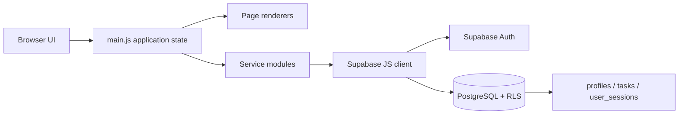

# Learn FlowDesk: A Complete Project Guide

This guide explains how FlowDesk is put together, how data moves through it, how its Supabase security works, and how to run, change, and deploy it. It is written to help you understand the code rather than only copy commands.

## 1. What FlowDesk is

FlowDesk is a browser-based team productivity dashboard. It uses:

- **HTML** for the page shell.
- **CSS** for layout, responsive behavior, colors, and typography.
- **Vanilla JavaScript with ES modules** for rendering and application behavior.
- **Vite** for local development and production builds.
- **Supabase Auth** for account sign-in and recovery.
- **Supabase PostgreSQL** for profiles, tasks, and best-effort session history.
- **Row Level Security (RLS)** to enforce which database rows each signed-in user can access.

The current application includes account creation and sign-in, a task dashboard, task management, session history, and read-only admin pages. It does **not** currently include a calendar view, habit tracker, or Pomodoro timer.

## 2. How the pieces fit together



The UI is intentionally split into page renderers and service modules:

- `main.js` coordinates the app. It stores the current signed-in user, profile, task list, current view, form state, and loading/error messages. It calls services and asks a page module to render.
- `js/pages/` contains functions that create DOM elements for a screen. These modules do not talk directly to the database.
- `js/services/` contains the Supabase operations for authentication, profiles, tasks, session records, and admin data.
- `js/lib/supabaseClient.js` creates one Supabase client from environment settings.
- `supabase/schema.sql` defines the database structure, triggers, RPC functions, grants, and RLS policies.

This separation makes it easier to tell whether a change belongs to the display, application flow, or database access layer.

## 3. Project files

```text
index.html                       HTML entry point and font loading
main.js                          Application state, navigation, event handlers
base.css                         Shared design system and responsive styling
js/config.js                     Reads Vite environment variables
js/lib/supabaseClient.js         Creates the Supabase client
js/pages/authPage.js             Sign-in, sign-up, and password forms
js/pages/signedInPage.js         Older/basic account page renderer
js/pages/dashboardPage.js        Overview cards and task summaries
js/pages/tasksPage.js            Task creation, editing, filtering, and list
js/pages/adminPage.js            Read-only profiles and session activity
js/services/authService.js       Supabase Auth calls
js/services/profileService.js    Current user's profile query
js/services/taskService.js       Task CRUD queries
js/services/sessionService.js    Session creation, heartbeat, and closure
js/services/adminService.js      Admin-only directory and summary queries
supabase/schema.sql              New-project database setup
supabase/stage6_admin_email.sql  Migration for older projects
supabase/README.md               Supabase setup and admin instructions
tests/manual-test-checklist.md   Checks to run manually; unchecked means unverified
.env.example                     Safe template for local Supabase settings
.gitignore                       Excludes local-only files and build output
package.json                     Project scripts and dependencies
vite.config.js                   Vite development server configuration
```

## 4. Run the app on your computer

Use PowerShell in the project directory:

```powershell
npm install
Copy-Item .env.example .env.local
notepad .env.local
npm run dev
```

In `.env.local`, set the URL and **public** anon/publishable key from your Supabase project:

```dotenv
VITE_SUPABASE_URL=https://your-project-id.supabase.co
VITE_SUPABASE_ANON_KEY=your-public-anon-or-publishable-key
```

Then restart Vite if it was already running. Vite reads environment settings when it starts. Open the local URL it prints, usually `http://localhost:5173/`.

To produce and inspect a production build:

```powershell
npm run build
npm run preview
```

`npm run build` writes static output to `dist/`. `npm run preview` serves that built output locally; it is not the development server.

## 5. Important security rule for environment variables

The browser must know the Supabase project URL and public anon/publishable key, so those values use the `VITE_` prefix. A public key is not a substitute for database security: RLS is what limits each user's data access.

**Never put a Supabase `service_role` key, database password, or private secret in a `VITE_` variable.** Vite embeds `VITE_` values in browser-accessible JavaScript. `.env.local` is ignored by Git; `.env.example` contains only blank placeholders and is safe to commit.

The root file named `password` is also ignored by Git. Keep credentials out of source files and screenshots.

## 6. App startup and rendering flow

1. `index.html` creates `<div id="app">` and loads `main.js` as an ES module.
2. `main.js` imports CSS, config, page renderers, and service functions.
3. `js/config.js` reads `import.meta.env.VITE_SUPABASE_URL` and `VITE_SUPABASE_ANON_KEY`.
4. `js/lib/supabaseClient.js` creates the Supabase client when both settings exist.
5. The app checks Supabase's saved Auth session. Supabase restores a signed-in user after a page refresh.
6. If the user is signed in, `main.js` loads their `profiles` row. Once the profile is available, it loads their tasks and renders the overview.
7. If the user is signed out, the sign-in page is rendered.

There is no separate client-side routing library. `currentView` in `main.js` selects Overview, My Tasks, or Admin, and `render()` replaces the contents of `#app` with the chosen page.

The pages build DOM nodes with `document.createElement` and set visible content with `textContent`. This keeps user-provided task and profile text from being interpreted as HTML. `replaceAppContent()` also restores focus to a field marked with a `data-focus-key`, which is useful because a render replaces the page DOM.

## 7. Sign-up, sign-in, and password recovery

The sign-in, create-account, reset-request, and set-new-password forms are rendered in `js/pages/authPage.js`. Their submit events are handled in `main.js`, which calls `js/services/authService.js`.

### Sign-up

- The browser submits the name as Auth user metadata and the email/password to Supabase Auth.
- Supabase may require the user to confirm their email before signing in.
- A database trigger creates `public.profiles` when the Auth user is created.
- The trigger copies the name and email, but does not accept a role from browser metadata. The database default sets the role to `user`.

In Supabase **Authentication → URL Configuration**, add the local redirect URL `http://localhost:5173/**`. For production, add the deployed site's URL and any required recovery redirect paths.

### Sign-in and refresh

Supabase Auth validates the password and stores its session in the browser. On refresh, the client restores the session; FlowDesk then queries the profile and tasks again. The task list itself is held in JavaScript memory while the page is open; the database remains the durable store.

### Password reset

The app requests a reset link with a redirect back to `/?reset-password`. The user follows the email link, enters a new password twice, and the app calls `auth.updateUser()`. Email delivery and rate limits are configured by Supabase, so a rate-limit error is an email-provider issue rather than a task-table problem.

## 8. Database tables and relationships

The schema creates three tables in the `public` schema:

### `profiles`

One row per Supabase Auth user. `profiles.id` is the Auth user's UUID. It stores the display name, email, role (`user` or `admin`), and creation time. Deleting the Auth user cascades to the profile.

The browser can update only `full_name`; it cannot change `role` or email. A trigger keeps the profile email in sync with Auth email changes.

### `tasks`

Each task has a UUID, owner (`user_id`), title, description, status, priority, optional due date/category, timestamps, and optional completion timestamp. The owner references `profiles.id` and is deleted with that profile.

Database constraints are a second line of validation: title must be 1–180 trimmed characters, description at most 2,000 characters, status one of `todo`, `in_progress`, or `done`, and priority one of `low`, `medium`, or `high`. An update trigger refreshes `updated_at`.

Indexes on `(user_id, status)` and `(user_id, due_date)` help common per-user task queries.

### `user_sessions`

Stores a best-effort application session record: UUID, owner, login time, optional logout time, and latest heartbeat time. Timestamps default to server time. Check constraints prevent logout or last-seen times earlier than login.

This is **not** a reliable attendance tracker. Closing a tab, browser crash, or loss of connectivity can prevent the logout update, leaving a row open and eventually stale.

## 9. Row Level Security (RLS)

RLS is enabled for all three public tables. The browser uses the public key, but Supabase evaluates each request as the signed-in user and checks grants and policies.

| Table | Policy | Effect |
| --- | --- | --- |
| `profiles` | `profiles_read_self_or_admin` | Read your own profile; admins may read all profiles. |
| `profiles` | `profiles_update_own_name` | Update only your profile row; SQL grants limit the updated column to `full_name`. |
| `tasks` | `tasks_select_own` | Read only rows whose `user_id` is your Auth UUID. |
| `tasks` | `tasks_insert_own` | Insert only rows owned by your Auth UUID. |
| `tasks` | `tasks_update_own` | Update only your own rows and keep ownership unchanged. |
| `tasks` | `tasks_delete_own` | Delete only your own rows. |
| `user_sessions` | `sessions_read_self_or_admin` | Read your own sessions; admins may read all sessions. |
| `user_sessions` | `sessions_insert_own` | Insert only your own session rows. |

The Admin menu is hidden from regular users for usability. That is **not** the security boundary: the RLS policies are. The admin check uses `public.is_admin()`, a narrowly granted `SECURITY DEFINER` SQL function with an empty `search_path`. This avoids recursive evaluation of the profiles policy while keeping object lookup explicit.

### Apply the database schema

For a new Supabase project, run the full `supabase/schema.sql` in the Supabase SQL Editor as the project owner. For the existing project used during development, the user applied the schema and confirmed RLS and its eight policies. Existing projects that used the earlier schema also need `supabase/stage6_admin_email.sql` so the admin directory can show emails.

The SQL editor verification queries are in `supabase/README.md`. Running them as owner checks installation; it does not prove what a regular authenticated user can access. Use two separate accounts to test isolation.

### Promote an administrator

There is no admin role selector during registration. After registering the intended account, a trusted project owner can promote it through SQL Editor using the procedure in `supabase/README.md`. The browser cannot update `role`. Do not add client-side role promotion.

## 10. Task management internals

`js/pages/tasksPage.js` renders the task editor, task cards, search, filters, and sort controls. It receives the task data and callbacks from `main.js`; it does not query Supabase.

`main.js` validates and normalizes the form before calling `js/services/taskService.js`:

- Create inserts a task with the current user's ID.
- Read selects task fields and orders newest-created first.
- Update edits fields by task UUID.
- Delete asks for confirmation and then deletes by UUID.
- Complete/reopen changes `status` and `completed_at`.

RLS independently enforces ownership even if someone edits browser code or sends a direct REST request. Search, filters, sort order, edit draft, and selected view are currently browser state; they are not saved as user preferences.

Dates use the user's local date for overdue and due-today comparisons. `due_date` is a PostgreSQL `date` without a time zone; it represents a calendar date, not a precise moment.

## 11. Dashboard calculations

`js/pages/dashboardPage.js` derives its numbers from the signed-in user's loaded task list:

- **Due today:** `due_date` equals today's local date.
- **In progress:** status is `in_progress`.
- **Completed:** status is `done`.
- **Overdue:** due date is before today and status is not `done`.
- **Completion percentage:** completed task count divided by total task count.
- **Coming up:** unfinished tasks with future due dates, sorted soonest first and limited to five.

These are calculated in the browser from real rows; there are no demo counts. Quick-create navigates to My Tasks and focuses the title field.

## 12. Session tracking

After authentication, `main.js` calls `startUserSession()` in `js/services/sessionService.js`:

1. It checks `sessionStorage` for a session row ID for this user and browser tab.
2. It reuses that row if it is open and its heartbeat is recent; otherwise it inserts a new row.
3. A timer calls the `touch_user_session` RPC every 60 seconds.
4. Explicit sign-out calls `close_user_session`, then signs out of Auth.
5. A `pagehide` event stops the timer; browser closure cannot reliably call the database, so it does not guarantee logout.

The database RPC functions validate `auth.uid()` and update only an open session belonging to that caller. The admin UI labels a session **Active** only when it has no logout time and the heartbeat is within two minutes. Otherwise it may be **Stale** or **Closed**. Duration for an open stale row is an estimate based on the last heartbeat.

## 13. Admin pages

`js/services/adminService.js` runs profile/session list and count queries in parallel. The profile and session lists are capped at the latest 500 rows; the UI then searches, filters, and paginates that loaded set in groups of 20. Counts can therefore exceed the number of loaded rows.

`js/pages/adminPage.js` presents:

- profile count, recent logins in the last seven days, active heartbeats within two minutes, and total session records;
- a People tab with name/email search and role filter;
- a Session activity tab with user and login-date filters;
- pagers for the rows currently loaded.

RLS still decides whether the queries succeed. Hiding a link or route in JavaScript alone would not protect database rows.

## 14. UI, colors, and fonts

`base.css` contains the layout, components, responsive breakpoints, and theme. The current requested palette is:

| Name | Hex | Main use |
| --- | --- | --- |
| Pale Grey | `#fdfdfe` | Card and panel surfaces |
| Solitude | `#e9ecf3` | Page background |
| Stardust Ballroom | `#dad1d2` | Borders and separators |
| Porch Ceiling | `#a2b1ba` | Secondary border/hover accent |
| Garish Green | `#4bc58f` | Success and progress accent |
| Autumn Sunset | `#f78555` | Primary actions and brand accent |

The UI uses Cormorant Garamond for display headings and DM Sans for body text. `index.html` loads these from Google Fonts. When offline or blocked, the CSS falls back to Georgia and system sans-serif fonts.

Responsive rules in `base.css` collapse the sidebar and grids at smaller widths. When you change spacing or colors, check the desktop and narrow-mobile layouts because later CSS rules can override earlier rules.

## 15. Deploying to Vercel

The intended deployment uses Vercel's Vite preset:

- Build command: `npm run build`
- Output directory: `dist`
- Environment variables: `VITE_SUPABASE_URL` and `VITE_SUPABASE_ANON_KEY`

Typical deployment sequence:

1. Verify the local production build with `npm run build`.
2. Push the project to a GitHub repository.
3. Import that repository into Vercel and select the Vite preset.
4. Add the two public Supabase environment values in Vercel's project settings for the production environment.
5. Deploy, then add the production domain to Supabase Auth's Site URL/allowed redirect URLs.
6. Test registration or sign-in, task reads/writes, refresh, reset links, and the admin page on the production domain.

Never use a service-role key as a Vercel `VITE_` variable. The database already has the schema and RLS; deploying the static frontend does not run SQL for you.

**Deployment status:** this guide does not claim the site is deployed. A GitHub remote and Vercel account connection are still needed to publish it. The current shell also previously blocked Vite/esbuild with `spawn EPERM`, so run the build in your normal project PowerShell before treating it as verified.

## 16. Git basics for this project

The project has been initialized as a local Git repository, and its source files have been staged. A first commit has not yet been created. `.gitignore` excludes `node_modules/`, `dist/`, `.env.local`, other local env files, caches, and the root `password` file.

Once a GitHub repository exists, the usual commands are:

```powershell
git remote add origin https://github.com/YOUR-ACCOUNT/YOUR-REPOSITORY.git
git branch -M main
git push -u origin main
```

If Git reports no commit, first create one with `git commit -m "Build FlowDesk productivity dashboard"`. Review `git status` before pushing. The first commit should include `.env.example`, not `.env.local`.

## 17. Troubleshooting

### `ERR_INTERNET_DISCONNECTED` on a Supabase request

The browser cannot reach the Supabase host. Reconnect the computer, reload the app, and retry. This is a network failure; it does not by itself mean the API key or table schema is wrong. Local Vite can run while Supabase is unreachable.

### `Failed to load resource: 404`

Open the failed request in DevTools and inspect its full URL. A 404 only identifies the particular missing resource; it may be unrelated to the task API request. If the missing URL is a page route, check Vercel's SPA rewrite behavior; if it is an icon or source map, it may not affect app behavior.

### Supabase says invalid API key

Check that `.env.local` contains the correct project URL and public anon/publishable key. Do not use a service-role key. Restart Vite after changing the file.

### Profile won't load after sign-in

Confirm the schema was applied, the `profiles` table has RLS enabled, the new-user trigger created the user's profile row, and `profiles_read_self_or_admin` is present.

### Admin menu is missing

The signed-in user's `profiles.role` must be `admin`. Role promotion is done by a trusted project owner in SQL Editor, not from the app. Sign out and back in or refresh profile state after changing the role.

### Admin page reports that email is missing

For an older project, apply `supabase/stage6_admin_email.sql`. The current main schema already contains the email field and synchronization trigger.

### `npm run build` or `npm run dev` says `spawn EPERM`

Vite uses esbuild while loading its config. If this occurs only inside a restricted tool shell, run the same command in your normal Windows PowerShell from the project folder. A successful earlier scaffold build does not verify the latest app code.

## 18. Current verification and honest limits

The user confirmed that sign-up/email confirmation/sign-in, profile display, refresh persistence, and sign-out worked; they also confirmed task-stage behavior, the admin profile directory, session activity, the applied migration, and the admin role. The session status rendering bug was corrected.

The manual checklist is `tests/manual-test-checklist.md`. It marks some user-confirmed behaviors, but the remaining unchecked items have not been verified. In particular, two-account RLS isolation, all task edge cases, all admin filters/counts, production build after all changes, and responsive production behavior still need checks. The browser previously showed `ERR_INTERNET_DISCONNECTED`, which prevented live task requests at that time.

## 19. Recommended learning path

Learn the project in this order:

1. **HTML and CSS:** read `index.html`, then trace the workspace and theme rules in `base.css`.
2. **JavaScript modules:** learn `import`/`export`, then read `main.js` and one small page renderer.
3. **Async JavaScript:** follow sign-in and task loading from `main.js` into the service modules. Study `async`, `await`, `try/catch`, and `Promise.all`.
4. **Supabase Auth:** trace the form handler to `authService.js` and observe how the Auth session is restored.
5. **SQL basics:** read table definitions, foreign keys, constraints, indexes, triggers, and functions in `supabase/schema.sql`.
6. **Security:** understand SQL grants and RLS separately. Practice proving task isolation with two accounts.
7. **Product behavior:** trace one task from form input to validation, insert, database row, reload, and dashboard count.
8. **Deployment:** build, commit, push, configure Vercel environment variables, and verify Auth redirects on the deployed domain.

### Exercises to check your understanding

- Add a task field and trace every place it must change: form, validation, service selection, SQL column, card display, and guide.
- Explain why the task service includes `user_id` on insert even though RLS checks it too.
- Explain what happens if someone manually calls the REST API to select another user's task.
- Calculate the dashboard's overdue count from a sample list using the user's local date.
- Explain why a session can show stale even if the user never clicked Sign out.
- Find where to add a new navigation item and name the renderer and state needed for a new screen.
- Add a calendar, habit tracker, or Pomodoro timer only after deciding its data model and RLS rules; these features are not implemented yet.

## 20. Glossary

- **API:** a defined way for the browser to ask a service to do something.
- **Auth session:** Supabase's saved proof that a user has signed in.
- **CRUD:** create, read, update, and delete.
- **Foreign key:** a database rule connecting one table's value to a row in another table.
- **Migration:** a SQL change applied to an existing database.
- **RLS:** row-level security; database rules that filter or restrict rows by caller.
- **RPC:** a PostgreSQL function called through Supabase's API.
- **Trigger:** a database function automatically run after an insert/update or before an update.
- **Vite:** the development server and build tool used for this frontend.
- **Environment variable:** a setting provided outside source code, such as a project URL.
